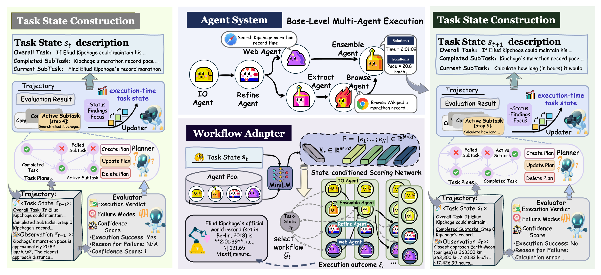

<div align="center">

<h1>EvoMAS: Learning Execution-Time Workflows for Multi-Agent System</h1>

<p>
  
  
  
</p>



</div>

## Overview

Most automated multi-agent system design methods pick a workflow **before** execution and reuse it for the whole task. **EvoMAS** adapts the workflow **during** execution instead. At every stage it:

1. builds an explicit **task state** with a *Planner → Evaluator → Updater* pipeline;
2. lets a learned **Workflow Adapter** build a stage-specific layered workflow from a fixed pool of candidate agents;
3. trains the adapter with **REINFORCE** from sparse, verifiable terminal task success. An evaluator-based process reward is also available.

| Component | Code |
| :-- | :-- |
| Planner / Evaluator | [`src/task_state`](src/task_state) |
| Updater + workflow execution | [`src/tools/executor_tool.py`](src/tools/executor_tool.py) |
| Workflow Adapter | [`src/workflow_adapter`](src/workflow_adapter) |
| Candidate agents | [`src/atomic_agents`](src/atomic_agents) |
| Policy-gradient training | [`src/optimizer`](src/optimizer) |

## Installation

```bash
conda create -n evomas python=3.11 -y && conda activate evomas
pip install -r requirements.txt
playwright install chromium --with-deps --no-shell

cp .env.template .env   # fill in OPENAI_API_KEY (and FIRECRAWL_API_KEY for web search)
```

## Usage

```bash
# Solve a single task
python run.py --config configs/evomas.py --task "Your question here"

# Run on a JSONL task file (fields: question, optional true_answer / task_id / file_name)
python run.py --config configs/evomas.py --dataset data/example_tasks.jsonl

# Train the Workflow Adapter (terminal reward; add the option below for the process-reward variant)
python train.py --config configs/evomas_train.py
python train.py --config configs/evomas_train.py --cfg-options optimizer_config.reward_mode=process

# Use a trained adapter
python run.py --config configs/evomas.py \
    --cfg-options workflow_adapter_config.resume_path=workdir/evomas_train/checkpoints/best
```

Main options are in [`configs/evomas.py`](configs/evomas.py): the candidate pool, the number of layers, the sampling threshold and the backbone models. `configs/evomas_4agents.py` gives the 4-agent pool. Outputs are written to `workdir/<tag>/`.

Offline unit tests (no API key needed): `python -m pytest tests -q`.

## Citation

```bibtex
@inproceedings{xu2026evomas,
  title     = {EvoMAS: Learning Execution-Time Workflows for Multi-Agent System},
  author    = {Xu, Chengdong and Yu, Chao and Ke, Kaiqiang and Liu, Ziheng and Wei, Jiaqi and
               Shao, Zibo and Li, Jungang and Guo, Weile and Wu, Yiling},
  booktitle = {Proceedings of the Eighth International Conference on Distributed Artificial Intelligence (DAI '26)},
  year      = {2026}
}
```

## Acknowledgements

The agent runtime and tools build on [smolagents](https://github.com/huggingface/smolagents) and [DeepResearchAgent](https://github.com/SkyworkAI/DeepResearchAgent).
